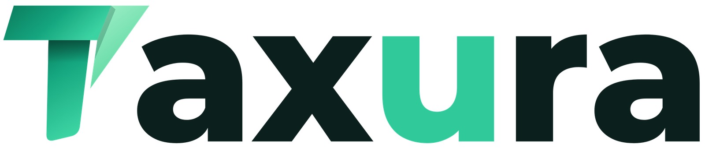

<div align="center">

<!-- ═══════════════════════════════ HERO ═══════════════════════════════ -->


<a href="https://git.io/typing-svg">
  
</a>

<br/>

<!-- Primary CTAs -->
<a href="https://taxura.app"></a>
&nbsp;
<a href="https://www.linkedin.com/in/rashidlatif-sse/"></a>
&nbsp;
<a href="mailto:rashidlatif.se@gmail.com"></a>

<br/><br/>

<!-- Quick facts -->


</div>

<br/>

<!-- ═══════════════════════════════ NAV ═══════════════════════════════ -->

<div align="center">

**[About](#-01--about-me)** · **[Currently Building](#-02--currently-building)** · **[Tech Stack](#-03--technology-stack)** · **[Journey](#-04--professional-journey)** · **[Projects](#-05--selected-projects)** · **[Philosophy](#-06--engineering-philosophy)** · **[Stats](#-07--github-analytics)** · **[Connect](#-09--lets-connect)**

</div>

<br/>

---

## 👨‍💻 01 / About Me

<table>
<tr>
<td width="62%" valign="top">

I'm **Rashid Latif**, an **AI-Native Full-Stack Engineer, Technical Lead, and Founder** with 6+ years of experience designing and building software products.

My work spans **SaaS, FinTech, SportsTech, enterprise applications, and AI-powered platforms**. I enjoy turning complex business requirements into scalable, production-ready solutions.

- 🏗️ &nbsp;Full-stack application architecture and development
- 🎨 &nbsp;Modern frontend engineering and backend systems
- 🤖 &nbsp;AI integrations, LLMs, and intelligent automation
- 🗄️ &nbsp;Database architecture and performance optimisation
- ☁️ &nbsp;Cloud infrastructure and production deployments
- 🧭 &nbsp;Technical leadership, mentoring, and engineering ownership

> **My philosophy:** Understand the problem. Architect the solution. Build it right. Make it scale.

</td>
<td width="38%" valign="top" align="center">


</td>
</tr>
</table>

---

## 🚀 02 / Currently Building

<div align="center">

<table>
  <tr>
    <td align="center" bgcolor="#FFFFFF" style="padding:28px">
      <a href="https://taxura.app">
        
      </a>
    </td>
  </tr>
</table>

<h2><a href="https://taxura.app">TAXURA.APP</a></h2>

### Making tax and financial workflows intelligent.

**AI-Powered Tax & VAT Automation Platform**


</div>

<br/>

<table>
<tr>
<td width="50%" valign="top">

#### 🧠 Document Intelligence
- AI-powered invoice extraction and document intelligence
- Intelligent PDF processing and data validation
- AI-powered financial data understanding

</td>
<td width="50%" valign="top">

#### ⚙️ Tax Workflows
- Automated VAT and tax workflows
- Multi-company invoice management
- Intelligent automation using LLMs and AI workflows

</td>
</tr>
<tr>
<td colspan="2" valign="top">

#### 🏗️ Platform
- Scalable SaaS architecture and cloud infrastructure built for growth

</td>
</tr>
</table>

<div align="center">

**Core technologies**


&nbsp;


<br/><br/>

<a href="https://taxura.app">
  
</a>

</div>

---

## ⚡ 03 / Technology Stack

<div align="center">

<table>
<tr>
<td align="center" width="50%">

#### 🎨 Frontend Engineering


</td>
<td align="center" width="50%">

#### 🧩 Backend Engineering


</td>
</tr>
<tr>
<td align="center" width="50%">

#### 🗄️ Databases & Cloud


</td>
<td align="center" width="50%">

#### 🤖 AI & Automation


<br/>


</td>
</tr>
</table>

</div>

---

## 🏢 04 / Professional Journey

<table>
<thead>
<tr>
<th width="6%"></th>
<th align="left" width="34%">Role &amp; Company</th>
<th align="left" width="60%">Highlights</th>
</tr>
</thead>
<tbody>
<tr>
<td align="center" valign="top" width="6%">🚀</td>
<td valign="top" width="34%"><b>Founder & Engineer</b><br/><sub>Taxura</sub></td>
<td valign="top" width="60%">Building an AI-powered Tax & VAT automation SaaS focused on intelligent invoice processing, financial workflows, and tax compliance.</td>
</tr>
<tr>
<td align="center" valign="top" width="6%">🧠</td>
<td valign="top" width="34%"><b>Senior Full-Stack Lead</b><br/><sub>Thrivo.ai</sub></td>
<td valign="top" width="60%">Leading buyer application development, AI-powered imports, MCP integrations, and scalable enterprise SaaS workflows.</td>
</tr>
<tr>
<td align="center" valign="top" width="6%">🏦</td>
<td valign="top" width="34%"><b>Senior Frontend Engineer & Team Lead</b><br/><sub>CADNZ LLC</sub></td>
<td valign="top" width="60%">Engineering enterprise applications, advanced DataGrid systems, product management workflows, and high-performance interfaces.</td>
</tr>
<tr>
<td align="center" valign="top" width="6%">🌍</td>
<td valign="top" width="34%"><b>Frontend Developer</b><br/><sub>Virtuzone · Dubai, UAE</sub></td>
<td valign="top" width="60%">Contributed to the PlanBuilder platform, developing business plan creation experiences and financial forecasting dashboards.</td>
</tr>
<tr>
<td align="center" valign="top" width="6%">🤖</td>
<td valign="top" width="34%"><b>Frontend Developer</b><br/><sub>TaxGPT</sub></td>
<td valign="top" width="60%">Worked on AI-powered tax solutions, integrating AI APIs and building responsive interfaces for automated tax insights.</td>
</tr>
<tr>
<td align="center" valign="top" width="6%">🏏</td>
<td valign="top" width="34%"><b>Senior Frontend Engineer</b><br/><sub>Frontend Team Lead · Crickslab</sub></td>
<td valign="top" width="60%">Developed real-time cricket scoring platforms, sports analytics dashboards, and white-label solutions for international cricket boards.</td>
</tr>
<tr>
<td align="center" valign="top" width="6%">✨</td>
<td valign="top" width="34%"><b>Product Development</b><br/><sub><a href="https://cultviaai.com/">Cultvia AI</a></sub></td>
<td valign="top" width="60%">Built Cultvia AI, contributing to the development of an AI-powered digital product.</td>
</tr>
<tr>
<td align="center" valign="top" width="6%">🔔</td>
<td valign="top" width="34%"><b>Product Development</b><br/><sub>BuilderBell</sub></td>
<td valign="top" width="60%">Contributed to building BuilderBell, adding to my experience in developing digital products and software solutions.</td>
</tr>
<tr>
<td align="center" valign="top" width="6%">💻</td>
<td valign="top" width="34%"><b>Frontend Developer</b><br/><sub>AntiqueLogic</sub></td>
<td valign="top" width="60%">Built responsive web applications, reusable UI components, and interactive digital experiences.</td>
</tr>
</tbody>
</table>

---

## ⭐ 05 / Selected Projects

A selection of products, open-source work, and engineering experiments from my GitHub portfolio.

<div align="center">

<a href="https://taxura.app"></a>
<a href="https://cultviaai.com/"></a>

</div>

<br/>

### 🤖 AI & Product Development

<table>
<tr>
<td width="25%" align="center"><b>Taxura</b><br/><sub>AI tax & VAT automation SaaS</sub><br/><br/>  </td>
<td width="25%" align="center"><b>Pantheon AI</b><br/><sub>AI product experiment</sub><br/><br/> </td>
<td width="25%" align="center"><b>NfoVision</b><br/><sub>Intelligent data & vision</sub><br/><br/> </td>
<td width="25%" align="center"><b>Prelearned Chatbot</b><br/><sub>Conversational AI</sub><br/><br/> </td>
</tr>
</table>

### 🎨 Frontend & Web Engineering

<table>
<tr>
<td width="20%" align="center"><b>Grow Portal</b><br/><sub>Web portal</sub><br/><br/></td>
<td width="20%" align="center"><a href="https://github.com/rashidlatifse/react-horizontal-scroll-indicator"><b>React Horizontal Scroll Indicator</b></a><br/><sub>React component</sub></td>
<td width="20%" align="center"><a href="https://github.com/rashidlatifse/react-vite-ts-starter"><b>React Vite TS Starter</b></a><br/><sub>Project template</sub></td>
<td width="20%" align="center"><a href="https://github.com/rashidlatifse/ant-design"><b>Ant Design</b></a><br/><sub>UI library</sub></td>
<td width="20%" align="center"><a href="https://github.com/rashidlatifse/superset"><b>Superset</b></a><br/><sub>Data platform</sub></td>
</tr>
</table>

### 🌱 Creative & Personal Projects

<table>
<tr>
<td width="16.6%" align="center"><b>Latif Atelier</b><br/><sub>Creative studio</sub><br/><br/></td>
<td width="16.6%" align="center"><a href="https://github.com/rashidlatifse/ai-3d-portfolio"><b>AI 3D Portfolio</b></a><br/><sub>3D web experience</sub></td>
<td width="16.6%" align="center"><b>My Family Tree</b><br/><sub>Personal project</sub><br/><br/></td>
<td width="16.6%" align="center"><b>Wistech Sync</b><br/><sub>Sync tooling</sub><br/><br/></td>
<td width="16.6%" align="center"><b>EstateMaster Mobile</b><br/><sub>Mobile app</sub><br/><br/></td>
<td width="16.6%" align="center"><b>Crickslab Clipping</b><br/><sub>Ball-by-ball video</sub><br/><br/></td>
</tr>
</table>

<div align="center">
<br/>
<a href="https://github.com/rashidlatifse?tab=repositories">
  
</a>
</div>

---

## 🧠 06 / Engineering Philosophy

```typescript
const engineeringMindset = {
  architecture: "Think beyond the immediate requirement",
  codeQuality:  "Clean, maintainable and testable",
  performance:  "Every millisecond matters",
  security:     "Never an afterthought",
  automation:   "Eliminate repetitive work intelligently",
  leadership:   "Ownership over titles",
  delivery:     "Turn ideas into working products",
  philosophy:   "Understand first. Engineer second.",
} as const;

export default engineeringMindset;
```

---

## 📊 07 / GitHub Analytics

<div align="center">


<br/><br/>


<br/>

<a href="https://github.com/rashidlatifse">
  
</a>

</div>

---

## 🌱 08 / Beyond Engineering

I'm always exploring new ideas, technologies, and ways to build better products.

<table>
<tr>
<td width="33%" valign="top">

🧬 **AI-native software engineering**<br/>
🕸️ **Autonomous agents and MCP ecosystems**<br/>
📄 **Intelligent document processing**

</td>
<td width="33%" valign="top">

☁️ **Cloud-native SaaS architecture**<br/>
💳 **FinTech and financial automation**

</td>
<td width="33%" valign="top">

⚡ **Developer productivity and engineering leadership**<br/>
🏢 **Building technology businesses**

</td>
</tr>
</table>

---

## 🤝 09 / Let's Connect

I'm always interested in connecting with founders, engineers, innovators, and people passionate about building meaningful technology.

<div align="center">

### Have an interesting idea? Let's build it.

<a href="https://www.linkedin.com/in/rashidlatif-sse/"></a>
&nbsp;
<a href="https://taxura.app"></a>
&nbsp;
<a href="mailto:rashidlatif.se@gmail.com"></a>

<br/><br/>

**Build intelligently. Engineer for scale. Create meaningful impact.**

<br/>


</div>
